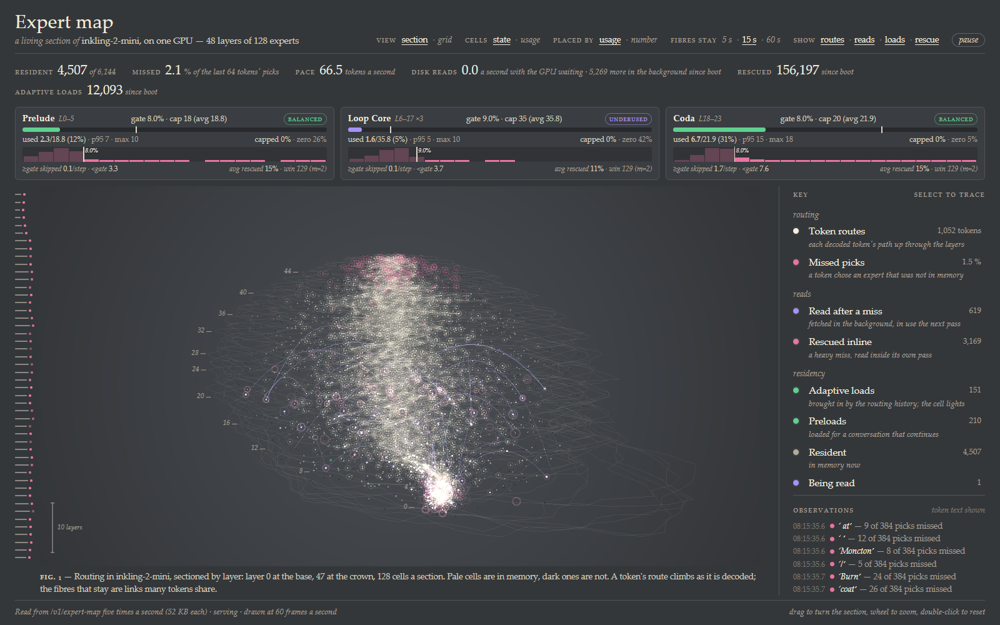

# SmallTide

**Adaptive MoE inference for [Inkling-2-Mini](https://huggingface.co/thinkingmachines/Inkling-2-Mini) (30B total / 3.8B active) on a single 16 GB AMD Radeon RX 9070 XT on Windows.**



*The live expert map (`http://127.0.0.1:8000/expert-map`) during a decode: each token's route through the 48 layers, the experts that are on the card, and the ones rescued or loaded in the background.*

Inkling-2-Mini's routed experts (~14.7 GB across 3,072 NVFP4 & MXFP8 experts) plus dense weights, KV cache, and drafter (~6+ GB) exceed a 16 GB consumer GPU. SmallTide brings [TideLM](https://github.com/raspy135/tideLM)-style adaptive expert residency and custom RDNA 4 HIP kernels to Windows: it keeps the highest-value experts resident in dedicated GDDR6 VRAM, promotes hot misses asynchronously from host RAM/NVMe, rescues high-weight misses inline on the GPU, and accelerates both greedy and sampled generation with Inkling-2-Mini's 3-layer DSpark speculative drafter.

Pre-built Windows releases embed the compiled `.hsaco` GPU kernels (`gfx1201` and `gfx1200`) inside a single `smalltide-cli.exe` — **no Rust toolchain, no ROCm SDK, and no Python environment required** to install and serve.

## Measured Performance (RX 9070 XT 16 GB, Windows 11)

Measured with `bench/bench.py`: median of 3 runs after a warmup (the two games: 1 run each), temperature 0.6, thinking off, speculative decoding on, AMD Adrenalin 26.10.44 driver, the settings of `.env.example` with `SMALLTIDE_RAM_GB=10`, and the monitor on the motherboard output so the card holds nothing but the model (see [Monitor on the card or on the motherboard](#monitor-on-the-card-or-on-the-motherboard)). *Decode* is generation speed; *TTFT* is the time to the first token (it includes reading the prompt).

| Workload | Prompt / output | Decode | TTFT |
| --- | ---: | ---: | ---: |
| `prose` (essay) | 58 / 1,024 | **68.6 tok/s** | 238 ms |
| `code` (LRU cache module + tests) | 74 / 1,024 | **68.7 tok/s** | 247 ms |
| `edit` (refactor a 1.4K-token file) | 1,425 / 1,024 | **72.3 tok/s** | 0.97 s |
| `random` (8K-token random prompt) | 8,256 / 1,024 | **87.9 tok/s** | 4.00 s |
| `angry-birds` (one-shot HTML game) | 76 / 8,192 | **75.7 tok/s** | 342 ms |
| `mario` (one-shot HTML game) | 66 / 8,192 | **93.8 tok/s** | 355 ms |

*`random` uses a prompt of random tokens, a worst case for the engine. Its answers are sampled and can end early: the three runs produced 527, 1,024, 1,024 tokens at 50, 88, 90 tok/s. Decode speed depends on how many experts a run has to copy in: the three runs of `edit` were 73, 72, 69 tok/s.*

Reading a prompt (prefill) runs at about 1,750 tokens a second on a cold 11,658-token prompt and about 1,450 on a 58,000-token one.

**Top-1 agreement with the full model.** Adaptive expert loading skips low-weight experts that are not on the card. Against a reference pass that loads and runs every routed expert, the engine picks the same most likely next token at **95.9%** of positions through draft-verify passes (the path speculative decoding uses) and **96.2%** through single-token steps. Measured with `bench/agreement.py` on four workloads, three prompts each, 1,024 tokens per prompt ([method and how to run it](#top-1-agreement-with-the-full-model)).

| Workload | Positions | Draft-verify passes | Single-token steps | Skipped routing weight (verify / single) |
| --- | ---: | ---: | ---: | ---: |
| `prose` | 3,072 | 96.1% | 95.8% | 0.5% / 0.6% |
| `code` | 3,072 | 96.5% | 96.3% | 1.0% / 0.9% |
| `edit` | 2,870 | 95.4% | 96.2% | 1.1% / 0.6% |
| `long` (9K-token prompt built from this repository's documents) | 3,072 | 95.4% | 96.6% | 1.7% / 0.9% |
| all | 12,086 | **95.9%** | **96.2%** | |

*Same card and settings as the table above. Fed its own reference, the exact configuration agrees at every position of the single-token path (128 positions checked), so the differences come from the skipped experts, in decode and in reading the prompt.*

The test says how often the top choice changes, not whether the answers are worse.

---

## Requirements

- **GPU:** an AMD Radeon RDNA 4 card with 16 GB: the RX 9070 XT (developed and measured here), or the RX 9070 or RX 9060 XT 16 GB (untested). See [Supported cards](#supported-cards).
- **OS:** Windows 11 (64-bit)
- **Driver:** **AMD Software: Adrenalin Edition 26.10.44 or newer** (ships `amdhip64_7.dll` and fixes the 26.5.1–26.9.1 WDDM residency cap bug — no ROCm SDK needed)
- **System RAM:** 32 GB recommended (16 GB of it holds the warm RAM expert tier so misses rescue over PCIe instead of NVMe; 10 GB with the monitor on the motherboard)
- **Disk:** ~36 GB free on NVMe (~21 GB Hugging Face checkpoint + ~14.7 GB packed `experts.stide`)

### Supported cards

The release carries two builds of the GPU kernels and loads the one for the card it finds.

| Card | Kernel build | Status |
| --- | --- | --- |
| Radeon RX 9070 XT (16 GB) | `gfx1201` | Developed and measured on this card. Every number in this README is from it. |
| Radeon RX 9070 (16 GB) | `gfx1201` | **Untested.** Same architecture and the same kernels as the XT, so it is expected to work. |
| Radeon RX 9060 XT 16 GB | `gfx1200` | **Untested: no such card was available.** It has its own kernel build, which compiles but has never run on the card. Expect a clearly lower speed: the card has about half the compute units and half the memory bandwidth of the RX 9070 XT. |

`.\smalltide.cmd probe` (the first step of `setup`, before the model download) prints the card, its architecture and the kernel build chosen, and runs a test kernel on the card. If you run an RX 9070 or an RX 9060 XT, please open an issue with that output, whether it works or not.

The RX 9070 GRE and the Radeon AI PRO R9700 are `gfx1201` as well and load the same kernels as the RX 9070 XT; they are untested too. The 8 GB RX 9060 XT and RX 9060 are not a target: the dense weights, KV cache and drafter take about 6 GB before the first expert. RDNA 3 and older cards are not supported. Details in [LIMITATIONS.md](LIMITATIONS.md).

---

## Quick Start (Pre-built Release — No SDKs Needed)

1. **Download and extract** `smalltide-v0.1.0-windows-x64-gfx1201.zip` from [GitHub Releases](../../releases).
2. **Run one-time setup** in PowerShell or Command Prompt inside the extracted folder:

```powershell
.\smalltide.cmd setup
```

`setup` copies `.env.example` → `.env`, verifies your GPU, its kernels & the HIP driver (`probe`), downloads [`thinkingmachines/Inkling-2-Mini`](https://huggingface.co/thinkingmachines/Inkling-2-Mini) via built-in `curl.exe` (resumable, ~21 GB; set `$env:HF_TOKEN` only if you want higher Hugging Face rate limits), and packs all 3,072 routed experts into 4 KB-aligned `experts.stide` (~15 s).

3. **Start the server** (pick the config matching where your monitor cable is plugged in):

```powershell
# Monitor on motherboard / iGPU (headless 9070 XT; uses .env copied from .env.example):
.\smalltide.cmd serve

# Monitor plugged into the RX 9070 XT (copy .env.monitor.example -> .env, or pass it directly):
.\smalltide.cmd serve .env.monitor.example
```

*(If your monitor is on the RX 9070 XT and you see tile glitches or slow streaming in Edge/Chrome, assign your browser to integrated graphics in Windows Settings — see [Monitor on the card or on the motherboard](#monitor-on-the-card-or-on-the-motherboard).)*

4. **Use it:**
   - **OpenAI API:** `http://127.0.0.1:8000/v1` (model name: `inkling-2-mini`) — works with Open WebUI, Continue, Cline, OpenCode, and any OpenAI-compatible client.
   - **Live Expert Map:** open **`http://127.0.0.1:8000/expert-map`** in your browser to watch routed experts, VRAM residency, inline rescues, and async promotions live.
   - **One-shot CLI test:**

```powershell
.\smalltide.cmd run -p "Write a concise explanation of speculative decoding." -n 256
```

5. **Optional: move the monitor cable to the motherboard for more resident experts.** With the monitor plugged into the RX 9070 XT, the desktop holds 3 to 5 GB of the card. If your CPU has integrated graphics, plug the monitor into the motherboard's video output instead and reboot: the card then holds nothing but the model, and about 2,100 of the 3,072 experts stay resident instead of about 1,750 (about 97% of the routing weight instead of about 90%). The numbers in [Measured Performance](#measured-performance-rx-9070-xt-16-gb-windows-11) were taken this way. Set `SMALLTIDE_RAM_GB=10` in `.env` for this setup; the details are in [Monitor on the card or on the motherboard](#monitor-on-the-card-or-on-the-motherboard). SmallTide works either way.

*(`smalltide.cmd` invokes `smalltide.ps1` with `-ExecutionPolicy Bypass`, so it works out of the box on stock Windows 11 without changing PowerShell execution policies.)*

---

## API Endpoints

| Method & Path | Description |
| --- | --- |
| `POST /v1/chat/completions` | OpenAI Chat Completions (streaming SSE & non-streaming, `reasoning_content`, `reasoning_effort`, tool calls, image input, `cache_prompt`) |
| `POST /v1/completions` | OpenAI Legacy Completions (streaming & non-streaming) |
| `GET  /v1/models` | Lists `inkling-2-mini` |
| `GET  /expert-map` | Live WebGL/Grid expert residency & routing visualizer |
| `GET  /v1/tide/stats` | Live TideLM telemetry (tok/s, hit rates by zone, rescues, skipped weight, VRAM) |
| `POST /v1/tide/config` | Live runtime tuning of `rescue_mode`, `rescue_threshold` and `rescue_auto_gate` |
| `GET  /health` | Health check |

Quick `curl.exe` smoke test:

```powershell
curl.exe -s http://127.0.0.1:8000/v1/chat/completions `
  -H "Content-Type: application/json" `
  -d '{"model":"inkling-2-mini","messages":[{"role":"user","content":"Say hello in 10 words."}],"max_tokens":64}'
```

---

## Image Input

Inkling-2-Mini reads images, and SmallTide runs its vision tower on demand: the tower's weights (636 MB) stay in the checkpoint file and are streamed through the GPU a layer at a time while an image is encoded, then everything is freed. Nothing of it is resident in RAM or VRAM, so text-only use is unaffected.

Send images as content parts of a user (or tool) message, in the OpenAI format with a base64 `data:` URL:

```json
{"role": "user", "content": [
  {"type": "text", "text": "What is in this picture?"},
  {"type": "image_url", "image_url": {"url": "data:image/png;base64,iVBORw0KGgo..."}}
]}
```

- **Formats:** PNG and JPEG. Anthropic-style parts (`{"type": "image", "source": {"type": "base64", "data": "..."}}`) are accepted too. `http(s)` image URLs are not fetched; send the image data.
- **Cost:** an image is used at its own resolution, one token per 40 × 40 pixel cell: 1024 × 1024 is 676 tokens, 1920 × 1080 is 1,296. Larger images are scaled down to `SMALLTIDE_VISION_MAX_TOKENS`.
- **Time:** encoding takes about 0.3 s for 1024 × 1024 and 0.8 s for 1920 × 1080 (RX 9070 XT), plus the prefill of the image's tokens. It uses 40–240 MB of VRAM for the duration of the encode.
- **Caching:** the prefix cache keys image positions by the image's content, so a follow-up turn or a repeated request does not encode or prefill the image again.

---

## How SmallTide Works

1. **Loop-aware adaptive residency (TideLM).** Inkling-2-Mini runs 24 physical MoE layers as 48 logical layers: 6 Prelude layers, 12 Loop Core layers executed **3 times per token**, and 6 Coda layers. SmallTide tracks every router pick into persistent routing priors (`<MODEL_DIR>/tide_priors.json`), automatically seeded on first boot from `profiles/inkling2-mini-priors.json` (aggregate routing shares only, zero user text). Value-per-byte placement prioritizes the 3× Loop Core first (~98%+ hit rate in VRAM), filling the rest of dedicated VRAM with the hottest Prelude NVFP4 and Coda MXFP8 experts.
2. **Windows DXGI residency-aware sizing.** On Windows WDDM, `hipMemGetInfo` reports shared system RAM as free VRAM, causing oversized allocations to silently drop ~10× in bandwidth over PCIe. With `SMALLTIDE_POOL_BUDGET=resident` (default), SmallTide queries DXGI's local residency budget and probes copy bandwidth across every 256 MiB window at startup (`fit_pools_to_resident`) so 100% of active expert slots stay on dedicated GDDR6.
3. **2-Stage Miss Handling + Fused GPU Spin-Wait Rescue.** Non-VRAM experts live warm in host RAM (`SMALLTIDE_RAM_GB=16`: every expert that is not on the card plus the ones most likely to leave it; a stray one is read back in the background) backed by 4 KB-aligned Win32 `FILE_FLAG_NO_BUFFERING` NVMe reads (`experts.stide`). Misses above each zone's gate, up to per-zone budgets of `33/30/35` per step, are copied over PCIe on a dedicated DMA stream and synchronized on-GPU by a fused HIP spin-wait + route-patch kernel (`SMALLTIDE_RESCUE_WAIT=spin`), while the rest are skipped and renormalized. The gates start at `0.07` and are adjusted while decoding so each zone spends about 80% of its budget (`SMALLTIDE_RESCUE_AUTO_GATE=1`). Hot misses promote asynchronously in the background.
4. **Lossless DSpark Speculative Decoding.** Inkling-2-Mini's 3-layer DSpark drafter (`mtp.safetensors`, ~418 MiB VRAM at 49K ctx) drafts up to 7 tokens per step with confidence-gated adaptive depth. Verification uses GPU-side top-k/top-p filtering (`smalltide_logits_filter_rows`) and exact stochastic rejection sampling, accelerating both `temperature = 0` and `temperature > 0` without altering the target distribution.
5. **Paged K8/V4 Global KV & Prefix Caching.** Global-attention KV (8 target layers + 1 drafter layer) is paged from a shared `SMALLTIDE_KV_TOKENS` pool across lanes with asymmetric **`k8v4`** quantization (`SMALLTIDE_KV_FMT=k8v4`: FP8 E4M3 keys for exact attention scores + per-32-group asymmetric INT4 values, saving ~472 MiB at 128K for +115 more resident experts). Multi-turn conversations restore prefix snapshots (including drafter KV state) from pinned host RAM without re-prefilling.

---

## Tuning `.env`

Edit `.env` and restart `.\smalltide.cmd serve`. Key knobs:

| Setting | Default | What it controls |
| --- | --- | --- |
| `SMALLTIDE_MAX_CTX` / `SMALLTIDE_KV_TOKENS` | `131072` | Context length & shared paged global-KV pool (128K default with `k8v4` across 2 lanes; raise to `196608` or lower to `65536` to trade context for experts). |
| `SMALLTIDE_KV_FMT` | `k8v4` | Global KV format: `k8v4` (FP8 keys + Q4 values, saves ~472 MiB @ 128K) or `fp8` (full FP8 K/V). |
| `SMALLTIDE_LANES` | `2` | Concurrent serving lanes (each extra lane reserves ~124 MiB of local KV rings + slack page). |
| `SMALLTIDE_RESCUE_MODE` | `threshold` | `threshold` (balanced), `exact` (copy every miss, bit-exact MoE), or `disabled` (fastest, skip inline misses). |
| `SMALLTIDE_RESCUE_THRESHOLD` / `..._CORE` | `0.07` / `0.07` | Routing-weight gate for inline rescues (Prelude & Coda / Loop Core). Lower gates rescue more: better fidelity, slower decode (a rescue costs about 0.7 ms). |
| `SMALLTIDE_RESCUE_BUDGET_PRELUDE` / `_CORE` / `_CODA` | `33` / `30` / `35` | Per-token inline rescue caps per architectural zone. |
| `SMALLTIDE_RESCUE_AUTO_GATE` | `1` | `1` adjusts each zone's gate while decoding so the zone uses about 80% of its rescue budget (`SMALLTIDE_RESCUE_AUTO_TARGET`): it starts at the threshold above, falls while budget is left over and rises when the zone goes over. The gate stays within `SMALLTIDE_RESCUE_AUTO_MIN`..`_MAX` (`0.03`..`0.5`). A zone with fewer misses than its budget ends at the lower bound. |
| `SMALLTIDE_PREFILL_CHUNK` | `1024` | Tokens per prefill chunk (64 to 1024). Larger chunks read a prompt faster for more scratch VRAM: 1024 costs about 80 resident experts against 256 and is almost twice as fast. |
| `SMALLTIDE_ATTN_VTILES` | `all` | Prefill attention reads value vectors decoded once per layer pass. `all` spends 268 MiB of VRAM at 128K context (about 55 resident experts) and reads a 58K-token prompt a third faster; `local` spends 4 MiB; `0` is off. |
| `SMALLTIDE_BATCH_RESCUE` | `1` | Two requests at once are decoded as one batch; `1` rescues missing experts for the batch like a draft-verify pass, `0` skips them (faster, lower fidelity). |
| `SMALLTIDE_IDLE_HEARTBEAT_MS` | `1000` | Idle GPU heartbeat; keep it on when no monitor is plugged into the card (see below). `0` turns it off. |
| `SMALLTIDE_SPEC` | `1` | Enable (`1`) or disable (`0`) DSpark speculative decoding. |
| `SMALLTIDE_VISION` / `SMALLTIDE_VISION_MAX_TOKENS` | `1` / `1536` | Image input on (`1`) or off (`0`), and the most tokens one image takes (larger images are scaled down). |
| `SMALLTIDE_RAM_PINNED_GB` | `0` | Experimental. This much of the RAM tier in page-locked memory: those experts upload to the card without a copy into the staging buffer (`2`: about 3% faster decode on a 12K-token prompt). Capped at 3; with 5 the server lost the GPU context, see [LIMITATIONS.md](LIMITATIONS.md). |
| `SMALLTIDE_RAM_GB` | `16` | Host RAM tier for non-VRAM experts. It has to hold every expert that is not on the card (about 4.8 MiB each) with room to spare; `16` holds all 3,072. Set `10` when the monitor is on the motherboard (see below). |
| `SMALLTIDE_HOST` / `SMALLTIDE_PORT` | `0.0.0.0` / `8000` | Server bind address (`127.0.0.1` for local-only) and port. |

> **Getting maximum resident experts on Windows:** Closing VRAM-heavy desktop apps (browsers with many tabs, Adobe Creative Cloud, games, hardware-accelerated Electron apps) before launching `.\smalltide.cmd serve` directly increases the number of experts SmallTide can keep resident on the card. Run `.\smalltide.cmd vram-probe` anytime to inspect your card's current resident headroom.

To reset learned routing priors back to the bundled seed, delete `models\Inkling-2-Mini\tide_priors.json` and restart the server.

---

## Monitor on the card or on the motherboard

Where the monitor cable goes decides how much of the 16 GB the model gets. A 4K desktop, a browser and a few Electron apps hold 3 to 5 GB of the card when the monitor is plugged into it; with the cable on the motherboard (the Ryzen's integrated graphics draws the desktop) the card holds nothing but the model.

| | Monitor on the RX 9070 XT | Monitor on the motherboard |
| --- | --- | --- |
| Resident experts (2 lanes, 128K context, drafter on) | about 1,750 of 3,072 | about 2,100 |
| Routing weight they cover | about 90% | about 97% |
| Desktop apps and the model | compete for VRAM: when the desktop's share grows, Windows moves part of the model to system RAM and decode drops to a quarter of its speed until the server is restarted | separate: the desktop uses system RAM through the integrated graphics |
| A rescue that stalls for more than about 2 s | Windows resets the graphics driver (`hipError_t=719`), the server exits | no driver reset was seen (nothing else asks for the card) |
| An idle card | stays awake (it draws the desktop) | is put to sleep by the driver unless the heartbeat runs: see below |
| System RAM | the desktop's graphics memory is on the card | the desktop's graphics memory comes out of system RAM (1 to 4 GB) |

**Setting it up with the monitor on the motherboard**

1. Move the cable to the motherboard's video output and **reboot**: programs keep using the graphics card they started on, so until then the desktop still sits on the 9070 XT.
2. Set `SMALLTIDE_RAM_GB=10` in `.env` (`.env.example` has 16): the desktop now lives in system RAM too.
3. Start the server. The startup line should show `VRAM free: … /15.92 GiB` (the engine picks the discrete card by itself; `SMALLTIDE_HIP_DEVICE` overrides it) and a resident count well above 2,000.
4. Leave `SMALLTIDE_IDLE_HEARTBEAT_MS=1000` at its default. Radeon drivers 26.5.1 and later put a card with no display to sleep about 10 seconds after its last GPU work, and Windows first moves everything in the card's memory - the whole model - into system RAM, which exhausts a 32 GB machine within seconds ([ROCm/TheRock#7221](https://github.com/ROCm/TheRock/issues/7221)). The heartbeat is a few milliseconds of GPU work once a second from the moment the server starts, loading included, and keeps the card awake. AMD reports the driver bug fixed in Adrenalin 26.9.2; that was not verified here, and 26.10.44 (build 32.0.31044.16) still has it.
5. Run one server at a time. A second one would load a second copy of the model next to the first; it now stops at once with `cannot listen on …`.

**Keeping the monitor on the RX 9070 XT (avoiding glitches and interference)**

1. Copy `.env.monitor.example` to `.env` (or launch directly with `.\smalltide.cmd serve .env.monitor.example`). It uses elastic 128K KV starting at 32K (`SMALLTIDE_KV_INITIAL_TOKENS=32768`), `SMALLTIDE_PREFILL_CHUNK=256`, and `SMALLTIDE_ATTN_VTILES=local` to reclaim VRAM for resident experts while leaving headroom for the desktop. (Use `.env.example` when the monitor is on the motherboard.)
2. **Move your browser / chat client to integrated graphics** if your CPU has an iGPU. Running Edge/Chromium on the 9070 XT alongside HIP compute can cause AMD D3D11/MPO speckled tile glitches inside browser windows and lowers decode tok/s because every streamed token repaints on the same GPU:
   - Open **Windows Settings → System → Display → Graphics**.
   - Select your browser or chat app. If it is not in the list, click **Add desktop app** (or **Browse**) and pick its `.exe` — for Microsoft Edge, `C:\Program Files (x86)\Microsoft\Edge\Application\msedge.exe`.
   - Set **GPU preference** to **Power saving** (integrated graphics).
   - Fully close the app (for Edge, close background `msedge.exe` processes in Task Manager or turn off *Startup boost*) and reopen it. Verify in `edge://gpu` that `GL_RENDERER` shows your integrated GPU instead of the RX 9070 XT.
   - *(Without an iGPU, turn off **Use graphics acceleration when available** in browser settings, or switch `edge://flags/#use-angle` from `Default` to `OpenGL` / `D3D9`.)*
3. Closing other VRAM-heavy apps before starting the server buys additional resident experts.

---

## Benchmarking

With `.\smalltide.cmd serve` running in another terminal (requires Python 3, standard library only):

```powershell
.\smalltide.cmd bench --workload prose --runs 3 --out results\prose.json
# every workload: prose, code, edit, random (--isl 8192), angry-birds, mario
foreach ($w in "prose","code","edit","random","angry-birds","mario") { .\smalltide.cmd bench --workload $w --out "results\$w.json" }
```

Each run prints decode speed, TTFT, skipped routing weight, inline rescues/token, VRAM hit rates by zone and disk reads; `--out` writes the summary JSON, and the one-shot games are saved to `results/oneshots/`.

### Top-1 agreement with the full model

Adaptive expert loading skips low-weight experts that are not on the card (see [LIMITATIONS.md](LIMITATIONS.md)). `bench/agreement.py` measures how often that changes the most likely next token. A reference pass runs every routed expert (`SMALLTIDE_RESCUE_MODE=exact`, `SMALLTIDE_SPEC=0`) and saves its greedy tokens. A second pass with your settings is fed those tokens one position at a time, and its own top choice is compared with the reference's at each position, once through draft-verify passes (the path speculative decoding uses) and once through single-token steps.

Stop the server first (the test needs the card to itself):

```powershell
python bench\agreement.py                                            # 4 workloads x 3 prompts x 1,024 tokens, about 12 minutes
python bench\agreement.py --workloads prose code --runs 1 --tokens 256   # about 2 minutes
```

The results are in [Measured Performance](#measured-performance-rx-9070-xt-16-gb-windows-11).

---

## Building from Source

Only needed if you want to modify the Rust engine/HIP kernels or choose which architectures the kernels are compiled for (`SMALLTIDE_HIP_ARCH`, comma-separated, default `gfx1201,gfx1200`):

- **Prerequisites:** [Rust](https://rustup.rs/) (MSVC toolchain) + **AMD ROCm HIP SDK for Windows** (`hipcc.exe`, auto-detected under `C:\Program Files\AMD\ROCm\*\bin\` or `ROCM_PATH` / `SMALLTIDE_HIPCC`).

```powershell
git clone https://github.com/raspy135/SmallTide.git
cd SmallTide
.\smalltide.cmd build
.\smalltide.cmd setup
.\smalltide.cmd serve
```

To build a standalone pre-built Windows release zip (for GitHub Releases):

```powershell
powershell -ExecutionPolicy Bypass -File .\scripts\package-release.ps1
```

See [LIMITATIONS.md](LIMITATIONS.md) for known constraints, [CREDITS.md](CREDITS.md) for attributions, and [docs/PROGRESS.md](docs/PROGRESS.md) for engineering notes.

## License

Repository code is [MIT-licensed](LICENSE). Inkling-2-Mini model weights are governed by [Thinking Machines' license](https://huggingface.co/thinkingmachines/Inkling-2-Mini).
